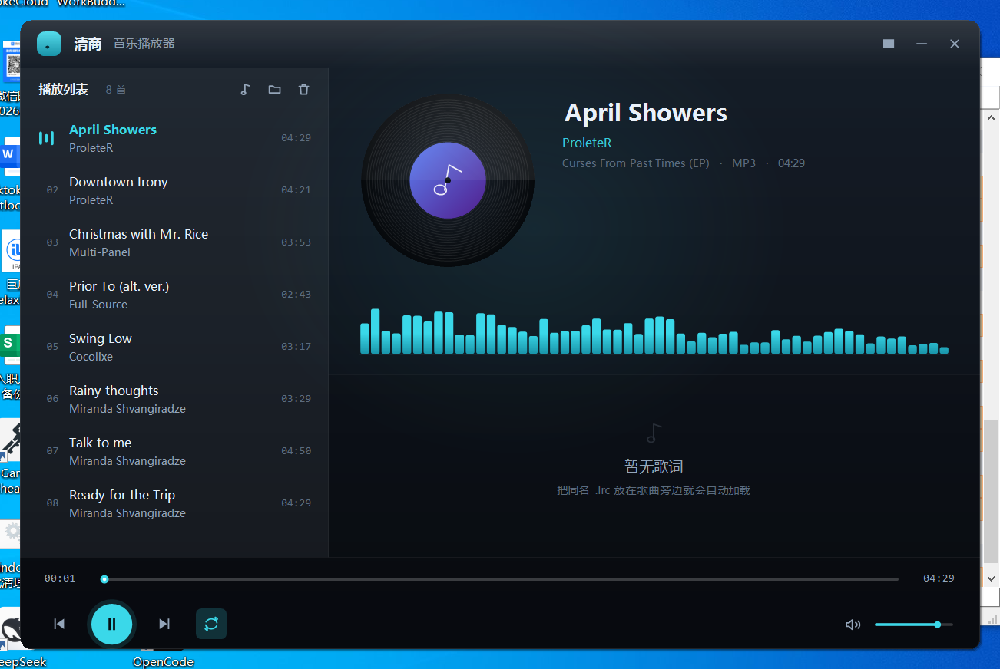
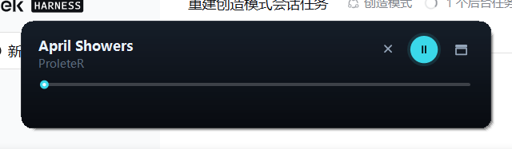

# 清商播放器 · QingShang

> 清商，古乐五音之一。宫商角徵羽，商属秋，其调清越。

一个从零手写的 Windows 本地音乐播放器。没有 Electron、没有 WebView、没有第三方 UI 库 ——
**整个界面是 GDI+ 一笔一笔画出来的**，音频走系统自带的 MCI。

最终产物是一个 **128 KB 的单文件 exe**，Win7 以上双击就能跑。



---

## 下载

| 文件 | 大小 | 说明 |
| --- | --- | --- |
| `QingShang.exe` | 128 KB | **便携版**。绿色单文件，双击即用，不写注册表，扔 U 盘里就能带走 |
| `QingShang-Setup-x.y.z.exe` | ~1.4 MB | **安装版**。多出开始菜单、桌面快捷方式、卸载入口，适合发给别人 |

两个里面装的是同一个程序，功能完全一样。挑顺手的用。

需要 .NET Framework 4.8 —— Win10 1803 以后的系统自带，Win7/8 需要装一次。

---

## 功能

**播放**

- 拖放文件 / 文件夹进窗口即可加载，子目录递归扫描
- 支持 `.m3u` / `.m3u8` / `.pls` 播放列表，任何工具导出的歌单拖进来就整批导入
- 播放 / 暂停 / 上一首 / 下一首，空格键和媒体键都能控制
- 四种播放模式：列表循环、单曲循环、随机、顺序播放
- 进度条可拖动定位，音量条带静音开关
- 双击列表项播放，右键可移除或在资源管理器里定位

**显示**

- 黑胶唱片随播放旋转，配色由曲目信息哈希生成，每首歌都不一样
- 56 段频谱柱，随音乐律动（合成能量场，不依赖 FFT 解码）
- LRC 歌词滚动高亮，当前行居中放大
- 自动读取 ID3v2 / ID3v1 标签，读不到就用文件名兜底
- 列表里直接显示时长：WAV 读 RIFF 头，MP3 按首帧比特率估算

**界面**

- 无边框圆角窗口，自绘标题栏，双击标题栏切换迷你模式
- 深空蓝配色 + 青蓝主色，100% / 125% / 150% 缩放都不错位
- 迷你模式 470×108，贴在桌面角落当个小题词板



---

## 快捷键

| 按键 | 作用 |
| --- | --- |
| `空格` | 播放 / 暂停 |
| `←` `→` | 后退 / 前进 5 秒 |
| `↑` `↓` | 音量 ±5% |
| `Esc` | 退出迷你模式 |
| 媒体键 | 播放暂停 / 上一首 / 下一首 |

---

## 支持格式

`.mp3` `.wav` `.wma` `.m4a` `.aac` `.flac` `.ogg` `.aiff`

实际能否播放取决于系统 MCI 解码器 —— mp3 / wav / wma 在所有 Windows 上都稳，
flac / m4a 看系统装没装对应解码器。

---

## 歌曲从哪来

播放器本身不带任何内容。三条路，从省事到折腾排：

### 1. 自己电脑里的歌

拖文件夹进来就行，子目录会递归扫。

### 2. 免费授权源（自带脚本，合法可商用）

Internet Archive 上有几十万条 CC 授权 / 公共领域的音乐，仓库里带了个脚本直接批量拉：

```powershell
# 默认从 netlabels 集合抓 40 首，存到 music\，生成 playlist-netlabels.m3u8
.\tools\get-free-music.ps1

# 想多要点
.\tools\get-free-music.ps1 -Count 120

# 换集合：78rpm 老唱片 / audio_music / musopen 古典 / opensource_audio
.\tools\get-free-music.ps1 -Collection 78rpm -Count 40 -OutDir oldsongs
```

跑完把生成的 `.m3u8` 拖进播放器窗口，整批导入。

同样的思路也能接别的免费源：

| 源 | 说明 |
| --- | --- |
| [Internet Archive](https://archive.org/details/audio) | 免费 API，无需注册，50 万+ 音频条目 |
| [Jamendo](https://developer.jamendo.com/) | CC 授权独立音乐，要注册免费 API key |
| [Free Music Archive](https://freemusicarchive.org/) | 网页直接下，CC 协议 |
| [Musopen](https://musopen.org/) | 古典乐，公共领域录音 |

### 3. 从商业平台拿

GitHub 上这类工具很多，但基本都是灰色地带，也没法直接接进这个播放器 ——
它们的音源是 JS 插件格式（MusicFree / 洛雪那一套），C# 这边吃不了。

现实的用法是：先用它们把歌下到本地，再用播放器导入。常见的几个：

| 项目 | Star | 说明 |
| --- | --- | --- |
| [lx-music-desktop](https://github.com/lyswhut/lx-music-desktop) | 54.9k | 洛雪音乐，Electron，音源脚本 |
| [NeteaseCloudMusicApi](https://github.com/Binaryify/NeteaseCloudMusicApi) | 30.2k | 网易云 API 服务，自己部署 |
| [MusicFree](https://github.com/maotoumao/MusicFree) | 28.1k | 插件化播放器，插件是 JS |
| [listen1_desktop](https://github.com/listen1/listen1_desktop) | 11.4k | 一个播放器听全网 |
| [musicdl](https://github.com/CharlesPikachu/musicdl) | 6.8k | 纯 Python 下载器，50+ 平台 |

---

## 构建

不需要 Visual Studio，也不需要装 .NET SDK。

**依赖**

- .NET Framework 4.8 运行时
- C# 编译器：Roslyn 的 `csc.exe`
- .NET Framework 4.8 引用程序集

**一键构建**

```powershell
powershell -ExecutionPolicy Bypass -File .\build.ps1
```

产物：`dist\QingShang.exe`

`build.ps1` 里写死了两个路径，按自己的环境改：

```powershell
$csc = "...\roslyn\tasks\net472\csc.exe"                            # Roslyn 编译器
$ref = "$env:USERPROFILE\tools\net48-refs\build\.NETFramework\v4.8"  # 4.8 引用程序集
```

两者都能从 NuGet 拿：

```powershell
curl.exe -L -o roslyn.zip "https://www.nuget.org/api/v2/package/Microsoft.Net.Compilers.Toolset/4.13.0"
curl.exe -L -o refs.zip   "https://www.nuget.org/api/v2/package/Microsoft.NETFramework.ReferenceAssemblies.net48/1.0.3"
```

**如果你有 .NET SDK**，也可以直接用项目文件：

```powershell
dotnet build src\QingShang\QingShang.csproj -c Release
```

**打安装包**（需要 Inno Setup 6）

```powershell
& "C:\Program Files (x86)\Inno Setup 6\ISCC.exe" installer\setup.iss
```

---

## 代码结构

```
src/QingShang/
├── Program.cs              入口，设置错误模式、全局异常兜底
├── MainForm.cs             主窗口：布局、绘制、命中测试、交互
├── app.manifest            DPI 感知 / 兼容性声明
├── Core/
│   ├── Track.cs            曲目模型
│   ├── TagReader.cs        ID3v2 / ID3v1 解析 + WAV/MP3 时长探测
│   ├── Lyrics.cs           LRC 解析与时间轴查找
│   ├── PlaylistFile.cs     M3U / M3U8 / PLS 播放列表解析
│   ├── MciPlayer.cs        winmm.dll 的 MCI 封装
│   ├── PlayerEngine.cs     播放列表 + 播放状态机 + 100ms 心跳
│   ├── AppSettings.cs      配置持久化（%APPDATA%\QingShang\settings.ini）
│   └── Diag.cs             运行日志
└── UI/
    ├── Theme.cs            配色、字阶、GDI+ 绘制辅助、DPI 缩放
    └── Icons.cs            24×24 网格上的矢量图标路径
```

**为什么全自绘**：WinForms 原生控件的外观被系统主题锁死，套模板又要跟 DPI、
透明背景、圆角打架。整窗自绘之后，布局、配色、动画、命中测试全部自己说了算 ——
代价是几百行 `OnPaint`，换来的是 128 KB 的体积和完全一致的观感。

**为什么用 MCI**：不用第三方音频库，不打包 ffmpeg。`mciSendString` 是系统自带的，
一行命令就能 open / play / seek / 调音量，mp3 和 wav 在 Windows 上的兼容性最好。

---

## 已知边界

- 不自带解码器，flac / m4a 能不能放取决于系统
- 没有内嵌封面图提取，唱片用的是哈希生成的渐变色
- 频谱是合成的节奏可视化，不是真实 FFT
- 暂不支持桌面歌词、自定义皮肤

---

## 许可

[MIT](LICENSE)。

仓库里不含任何音频文件。程序本身与任何音乐平台的官方无关。
